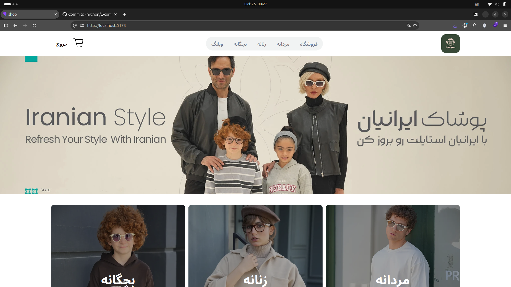
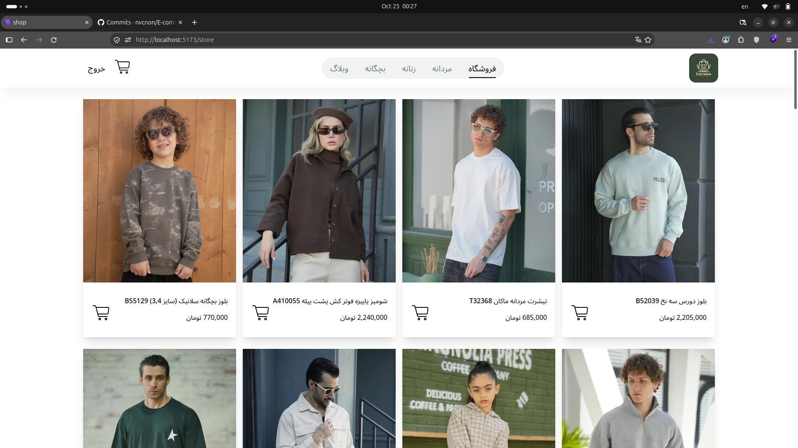
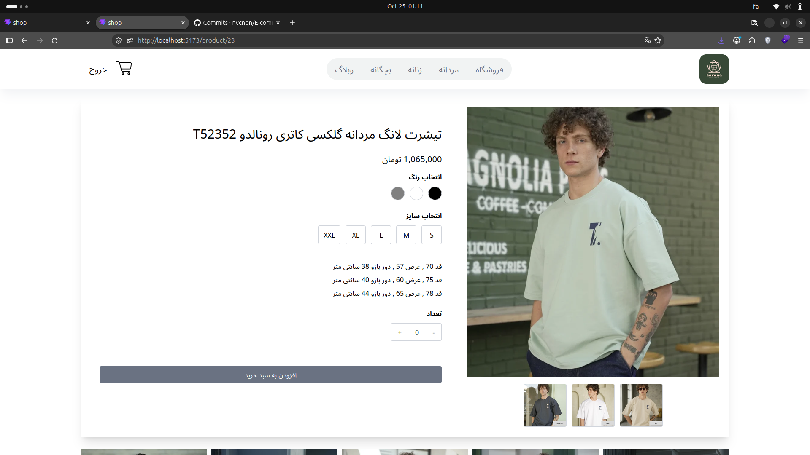
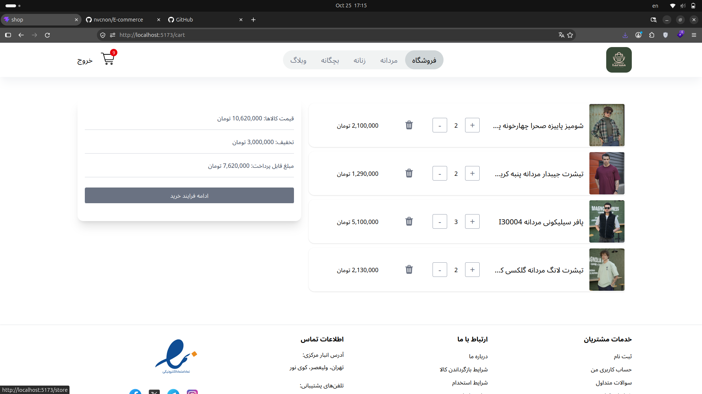
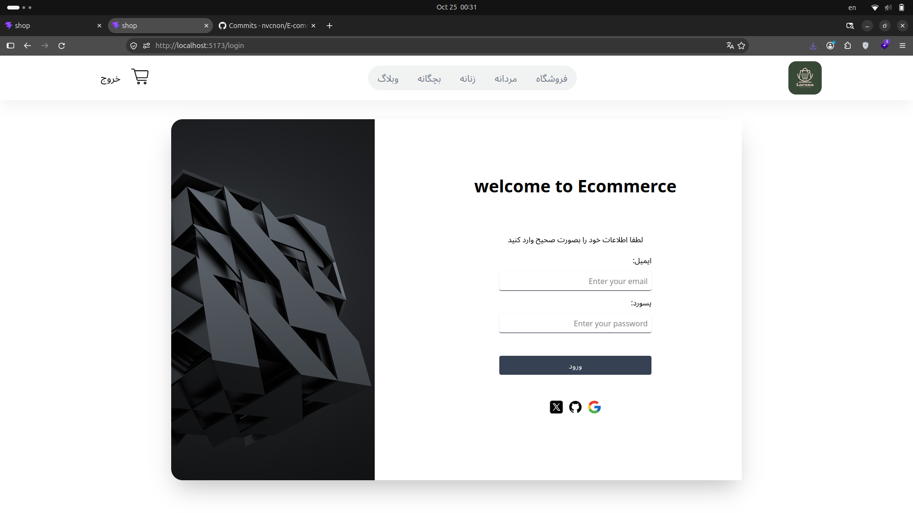

# 🛍️ E-Commerce — React + TypeScript

A responsive e-commerce frontend built with React, TypeScript, React Router, Tailwind CSS, Axios, Context API, and JSON Server.

This project demonstrates practical frontend development skills through reusable components, global state management, API integration, protected routes, URL-based filtering, local persistence, and responsive UI design.

## 📸 Screenshots

### 🏠 Home Page



### 🛍️ Store



### 📦 Product Details

**Desktop**



**Mobile**


### 🛒 Shopping Cart




### 🔐 Login Page




## ✨ Features

- Product listing and product details
- Product search
- Category filtering
- URL-based search and filtering
- Shopping cart management
- Increase and decrease product quantities
- Remove products from the cart
- Cart quantity and total price calculation
- Login and logout
- Protected routes
- Authentication state persistence
- Cart persistence using Local Storage
- Magazine / blog section
- Responsive layouts
- Reusable React components
- Interactive Swiper sections

## 🛠️ Tech Stack

### Frontend

- React
- TypeScript
- React Router
- Tailwind CSS
- Axios
- Context API
- Custom Hooks
- Swiper

### Development Tools

- Vite
- JSON Server
- Git
- GitHub

## 🏗️ Architecture

The project separates UI components, application state, API communication, and reusable logic.

### API Flow

```text
React Components
       ↓
 services/api.ts
       ↓
     Axios
       ↓
   JSON Server
```

### Authentication Flow

```text
    Login Page
         ↓
Authentication Context
         ↓
   services/api.ts
         ↓
     JSON Server
```

Authentication state is shared across the application using React Context API.

### Shopping Cart Flow

```text
 Product Interaction
         ↓
 ShoppingCartContext
         ↓
     Cart State
         ↓
    Local Storage
```

The shopping cart uses Context API for shared state and Local Storage to persist cart data across page reloads.

## 🔐 Authentication

The application includes a basic authentication flow for demonstrating login, logout, and protected routes.

Features include:

- Login and logout
- Shared authentication state
- Protected pages using a reusable `PrivateRoute` component
- Authentication state persistence

**Note:** Authentication uses JSON Server as a mock backend. This implementation is intended for frontend demonstration purposes and is not suitable for production security.

## 🛒 Shopping Cart

The shopping cart is implemented using React Context API.

Users can:

- Add products to the cart
- Increase or decrease product quantities
- Remove products from the cart
- View the total quantity of items
- View the total price
- Retain cart data using Local Storage

## 🔎 Search & Category Filtering

The Store page supports product search and category filtering.

Filtering state is synchronized with the URL using React Router's `useSearchParams`.

Examples:

```text
/store?category=men
/store?category=women
/store?search=kids
```

URL-based filtering makes the current search and category selection shareable and keeps navigation predictable.

## 🧩 Reusable Components

The application uses reusable components to keep the UI modular and maintainable.

Examples include:

- `Navbar`
- `Footer`
- `Container`
- `ProductItem`
- `CartItem`
- `ProductPage`
- `CategorySection`
- `Layout`
- `PrivateRoute`

## 🪝 Custom Hooks

The project includes a reusable `useLocalStorage` hook for synchronizing React state with browser Local Storage.

Example:

```tsx
const [value, setValue] = useLocalStorage("key", initialValue);
```

This approach keeps Local Storage logic reusable and avoids duplicating the same logic across components.

## 📱 Responsive Design

The interface is designed for desktop, tablet, and mobile screens.

Responsive layouts are implemented using Tailwind CSS and responsive Swiper configurations.

## 🎞️ Interactive UI

Swiper is used to create interactive product and category sections.

Depending on the section, the implementation includes features such as:

- Responsive slides
- Pagination
- Navigation
- Autoplay
- Coverflow effects

## 🗺️ Application Routes

| Route | Description |
|---|---|
| `/` | Home page |
| `/store` | Product store |
| `/product/:id` | Product details |
| `/cart` | Shopping cart |
| `/login` | Login page |
| `/store?category=men` | Men's products |
| `/store?category=women` | Women's products |
| `/store?category=kids` | Kids' products |

## 🚀 Getting Started

### Prerequisites

- Node.js
- npm

### 1. Clone the repository

```bash
git clone https://github.com/nvcnon/E-commerce.git
cd E-commerce
```

### 2. Install dependencies

```bash
npm install
```

### 3. Start the mock API

```bash
npm run api
```

JSON Server provides the local API used by the application.

### 4. Start the frontend

Open a second terminal in the project directory and run:

```bash
npm run dev
```

The frontend and mock API must run simultaneously.

## 🧪 Demo Account

Use the following credentials to test the authentication flow:

```text
Email: test@gmail.com
Password: 123456
```

This account is intended for local development and demonstration purposes. Make sure the credentials match the user data in the local JSON Server database.

## 👨‍💻 Author

**Sajjad Naghavi**

Frontend Developer

📍 Qom / Tehran, Iran

📧 [nvcnon@gmail.com](mailto\:nvcnon@gmail.com)

💻 [GitHub](https://github.com/nvcnon)
